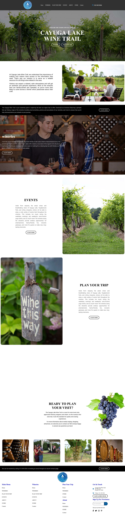
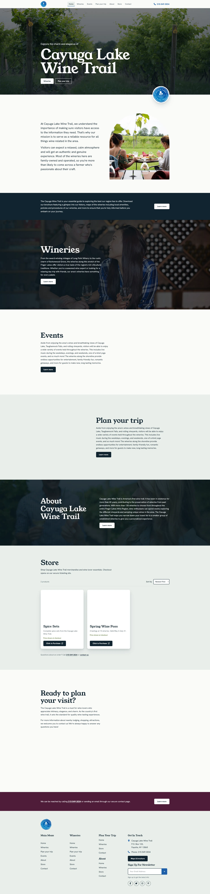

# Cayuga Lake Wine Trail: Redesign

A practice redesign of a Cayuga Lake Wine Trail landing page, America's first wine trail. It is a single static page built with HTML, CSS and vanilla JavaScript. No framework, no build step, no backend.

I first built this page as a practice exercise, recreating my mentor's [reference design](https://peppy-kelpie-f15691.netlify.app/) ([my build](https://cayuga-lake-flex.netlify.app/)). This repo is my redesign of it: same content, new design, structure and interactions, plus a new Store section.

## Before and after

| Before | After |
| :---: | :---: |
|  |  |
| [Live version](https://cayuga-lake-flex.netlify.app/) | Open `index.html` locally |

### What changed

- **Typography:** uppercase system serif headings replaced with Young Serif for display text and Hanken Grotesk for body text.
- **Color:** black strips replaced with a palette built from deep ink, lake blue, grape and vine green.
- **Imagery:** full-bleed stacked photos replaced with arch-masked and rounded images, a hero with a rotating seal badge, and a staggered photo gallery.
- **Navigation:** sticky header that shrinks on scroll, with a scroll progress bar, active-section highlight and a CSS-only mobile menu.
- **Motion:** hero parallax, photo reveal on scroll and a short entrance animation. All of it is disabled for users who prefer reduced motion.
- **New:** Store section with product cards and sorting.

## Features

- Responsive layout from phone to desktop (breakpoints at `64rem`, `56rem`, `52rem` and `30rem`)
- Fluid type and spacing with `clamp()` and CSS custom properties
- Sticky header with progress bar, current-section highlight and mobile menu that closes on link click or <kbd>Esc</kbd>
- Store section with product cards and a sort control (Newest First, Name: A–Z, Name: Z–A, Random)
- Newsletter form with client-side email validation and inline confirmation
- Accessibility: skip link, landmarks, visible focus styles, `aria-live` status messages, `prefers-reduced-motion` support
- Works without JavaScript. JS only adds enhancements.

## Store section

- Two products: **Spice Sets** and **Spring Wine Pass**
- "Click to Purchase" opens the TicketSpice checkout in a new tab
- Sorting reorders the cards in the browser; there is no cart and no payment handling on this page
- No prices are listed, so cards show "Price shown at checkout"
- Product photos are placeholders taken from the gallery images

## Tech

- HTML5, CSS3 (flexbox, custom properties, `clamp()`), vanilla JavaScript (`IntersectionObserver`, no libraries)
- [Google Fonts](https://fonts.google.com): Young Serif, Hanken Grotesk
- [Font Awesome](https://fontawesome.com) 6.6.0 icons via CDN

## Project structure

```
CAYUGA_LAKE_REDESIGN/
├── index.html
├── style.css
├── script.js
├── img/            # photos and logo
└── screenshots/    # before.png, after.png
```

## Run locally

Open `index.html` in a browser, or serve the folder:

```bash
python3 -m http.server 8000
```

Then visit <http://localhost:8000>. An internet connection is needed for the fonts and icons.

## Known limitations

- Static page: the newsletter form validates the email but sends it nowhere.
- Several "Learn more" buttons are `href="#"` placeholders.
- Footer link lists repeat the same links.

## Credits

Content, logo and photos belong to their original owners. This is a personal practice project for learning, not affiliated with the Cayuga Lake Wine Trail.
